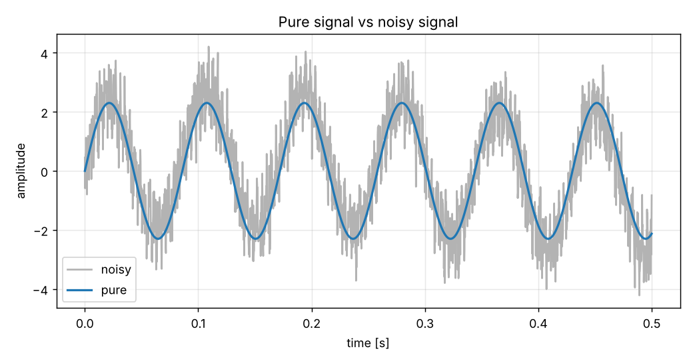
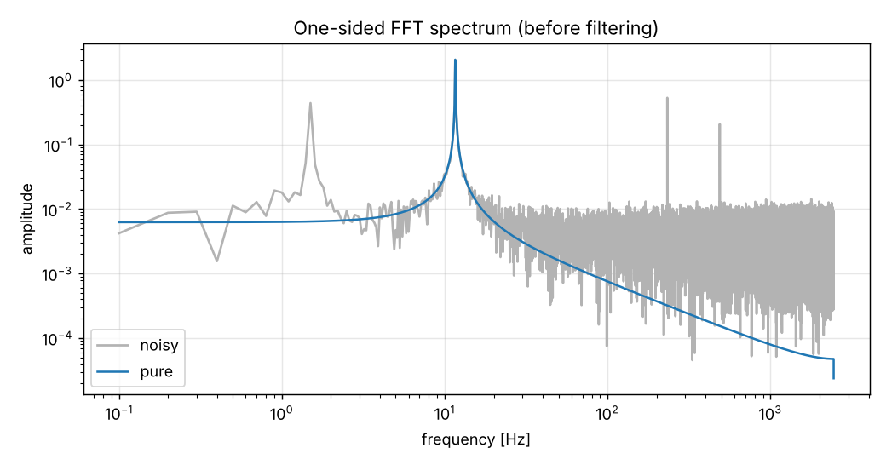
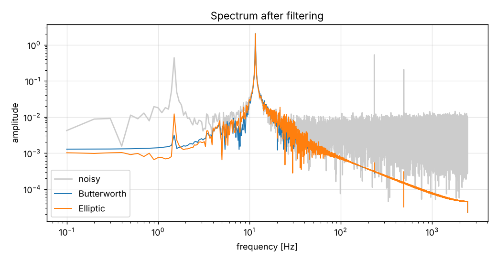
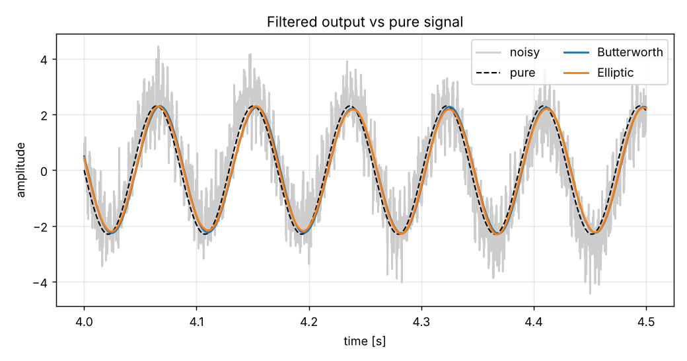
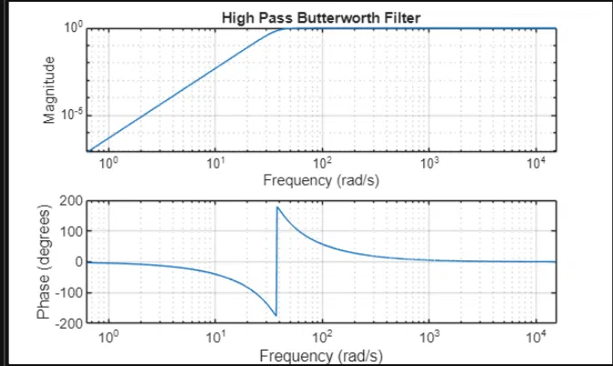
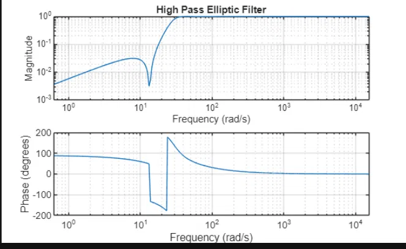
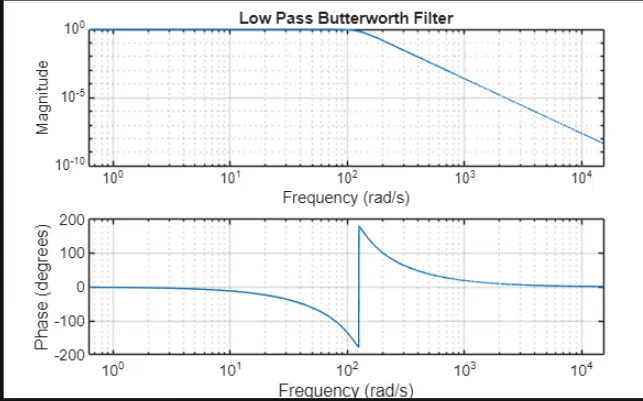
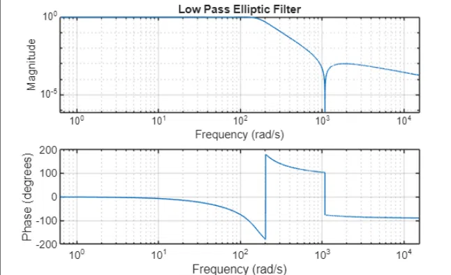

# Aerospace Measurements & Signal Processing Lab (MATLAB)

An end-to-end experimental data reduction, spectral diagnostics (FFT), synthetic noise modeling, and analog filter design suite developed in **MATLAB** for the **Aerospace Measurements & Instrumentation Lab** at Cairo University.

---

## Repository Structure

| Module Directory | Core Deliverables | Technical Focus |
| :--- | :--- | :--- |
| **[`01_Wind_Tunnel_Data_Reduction`](./01_Wind_Tunnel_Data_Reduction)** | `.mlx` Live Script & `.pdf` Report | Body-to-wind axis force transformation ($N, A \rightarrow L, D$) across Angles of Attack ($\alpha$). |
| **[`02_Noise_Modeling_and_Identification`](./02_Noise_Modeling_and_Identification)** | `.mlx` Live Script & `.pdf` Report | Time/Frequency domain analysis (`FFT`), synthetic noise injection, and blind signal diagnostics. |
| **[`03_Analog_Filter_Design_and_Evaluation`](./03_Analog_Filter_Design_and_Evaluation)** | `.mlx` Live Script & `.pdf` Report | Butterworth vs. Elliptic filter synthesis, Bode response analysis, and phase-shift trade-off evaluation. |
| **[`Assets`](./Assets)** | High-Res Figures (`.png`) | Spectral plots, time-domain overlays, and filter frequency responses. |

---

## Technical Scope & Methodology

### 1. Wind Tunnel Aerodynamic Data Reduction
* **Coordinate Transformation:** Converted raw wind tunnel balance measurements from body-axis **Normal ($N$)** and **Axial ($A$)** force components into aerodynamic **Lift ($L$)** and **Drag ($D$)** forces as a function of Angle of Attack ($\alpha$):
  $$L = N \cos(\alpha) - A \sin(\alpha)$$
  $$D = N \sin(\alpha) + A \cos(\alpha)$$
* **Experimental Validation:** Processed multi-point angle sweeps and generated clean aerodynamic force curves.

### 2. Spectral Analysis & Blind Signal Diagnostics (FFT)
* **Time & Frequency Domain Mapping:** Implemented Fast Fourier Transform (**FFT**) workflows to inspect single-sided amplitude spectra on logarithmic scales (`loglog` / `semilogy`).
* **Synthetic Noise Modeling:** Generated and superimposed two distinct interference profiles—broadband random noise and narrowband tonal harmonics—onto clean reference signals to evaluate spectral corruption.
* **Blind Signal Identification:** Established a diagnostic procedure to inspect external/unknown signal datasets, isolate the fundamental carrier frequency (~11.5 Hz) from low- and high-frequency interference, and derive filter cutoff requirements.

### 3. Analog Filter Design & Performance Trade-Offs
* **Filter Topology Comparison:** Designed, simulated, and benchmarked **Butterworth** and **Elliptic** filters (High-Pass & Low-Pass stages) using MATLAB's *Analog Filter Designer* and Transfer Function (`tf`) models.
* **Intrinsic Frequency Response:** Plotted Magnitude $|H(j\omega)|$ and Phase Shift $\angle H(j\omega)$ characteristics across frequency decades to compare passband flatness, stopband notches, and roll-off steepness.
* **Post-Filtering Fidelity:** Evaluated recovered time-domain waveforms against the ground-truth pure signal, quantifying the engineering trade-off between aggressive noise attenuation and filter-induced **phase shift**.

---

## Visual Results & Signal Conditioning Gallery

### Signal Recovery & Spectral Filtering
| Time Domain: Pure vs. Noisy Signal | Frequency Spectrum (Before Filtering) |
| :---: | :---: |
|  |  |

| Frequency Spectrum (After Filtering) | Time Domain: Filtered Output vs. Pure (Phase Shift) |
| :---: | :---: |
|  |  |

### Analog Filter Frequency Responses (Magnitude & Phase)
| High-Pass Butterworth Filter | High-Pass Elliptic Filter |
| :---: | :---: |
|  |  |

| Low-Pass Butterworth Filter | Low-Pass Elliptic Filter |
| :---: | :---: |
|  |  |

---

## How to Use
1. **Quick Review:** Open any `.pdf` report inside the module folders to view formatted code, equations, and embedded plots directly in your browser.
2. **Interactive Execution:** Download the `.mlx` Live Scripts and open them in **MATLAB** (R2021b or newer recommended) with the **Signal Processing Toolbox** installed.

---

## Author
**Mohammed Abbass Abdallah Abdalhmid**  
Aerospace Engineering Student — Faculty of Engineering, Cairo University
